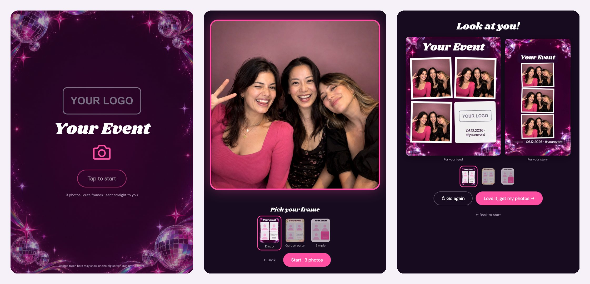

# Event Photo Booth

An iPad photo booth for your event. Guests take 3 photos, pick a frame, and walk away with an Instagram post and a story, ready to share. They grab them with a QR code (or by email). Every photo lands on a live photo wall, and an end-of-night slideshow builds itself.

You design the frames by describing them. Codex draws the art on your ChatGPT plan, so there's no per-image cost. The booth adds your event name, date and logo, so the words are always spelled right.

## What you get

- **The booth** for an iPad (or any tablet or laptop with a camera): countdown, 3 shots, swap frames on the preview, QR code to take them home
- **Two sizes per guest:** a 1080 × 1350 feed post and a 1080 × 1920 story
- **A photo wall** for a TV during the event, and a **slideshow** for the projector at the end
- **An admin page:** every photo, the guest list (download as a spreadsheet), delete buttons
- **Optional email:** guests get their photos in their inbox, and can tick "keep me posted" so you build your list
- **3 starter frames** (Disco, Garden party, Simple) and a one-line way to make more

## What you need

- A computer with **Claude Code** (or Codex)
- The **Codex app**, signed in with ChatGPT, for drawing frames (free with your ChatGPT plan)
- A free **Netlify** account, to put it online. The free plan allows business use
- On the day: an iPad that's had its updates (iPadOS 17 or newer), a stand, a charger and wi-fi. A TV or projector for the wall is a bonus
- Optional: a free **Resend** account and your own domain, to email guests their photos

## Set it up (the easy way)

1. Download this folder and open it in Claude Code (or Codex).
2. Say: **"Set up my photo booth"**. Claude asks for your event name, date, logo, colours and fonts, and does the rest.
3. Say: **"Make me a new frame: <describe the look>"**, as many times as you like. For example, *"Make me a new frame: pink and gold art deco, like a 1920s party."*
4. Try it on your laptop. Claude gives you a links file: open the booth link in Chrome and take a photo with your webcam.
5. Say: **"Put it live"**. Claude walks you through Netlify and gives you the live links.

That's it. On the day, open the admin page on your laptop, scan its QR code with the iPad, and you're in.

## The guides

| Guide | What's in it |
|---|---|
| [Customise it](docs/CUSTOMISE.md) | Every setting in plain English: words, colours, fonts, logo, camera, email, wall |
| [Make frames with Codex](docs/FRAMES-WITH-CODEX.md) | 3 ways to make frames: from Claude, inside Codex, or in Canva. Plus how to write a good brief |
| [Go live](docs/GO-LIVE.md) | Netlify step by step, turning on email, and what the free plans allow |
| [On the day](docs/ON-THE-DAY.md) | iPad setup, the checklist, the wall and slideshow, and what to do afterwards |
| [Build your own](prompts/build-your-own.md) | A prompt to have Claude build a booth like this around your own tools instead |

## What it costs

Nothing, for most events:
- **Netlify free plan:** 300 credits a month. Each time you put a new version live uses 15, so test on your computer first and go live once or twice. Photos and visits for a normal event use a handful. If the credits run out, Netlify pauses the site until next month, so don't redeploy 20 times the week of your event.
- **Codex:** frame art comes out of your normal ChatGPT plan's Codex limits.
- **Resend free plan (optional email):** up to 100 emails a day. Past that, guests still get the QR code.

## Your guests' privacy

Guests' photos and emails are personal information, and you're looking after them:
- The booth tells guests their photos may show on the big screen (change the wording in the settings).
- The "keep me posted" box starts unticked. Only add people who ticked it to your mailing list.
- Photo links are long and random, and the wall and slideshow need your booth key. Only the guest (and your screens) can see their photos.
- After the event, download the guest list, then hit **Delete everything** on the admin page.

## What's in the folder

| Where | What it is |
|---|---|
| `public/booth.config.json` | **all your settings**: event name, colours, fonts, every word on screen |
| `public/frames/` | one folder per frame: its art + a small `frame.json` |
| `public/brand/logo.png` | your logo |
| `public/*.html`, `public/js/`, `public/css/` | the booth, wall, slideshow, guest page, admin page and frame preview |
| `netlify/functions/` | the small server bits: saving photos, the wall list, the admin page |
| `tools/` | `make-frame.sh` (Codex draws a frame), `check.mjs` (checks your setup), `links.sh` (your private links) |
| `prompts/frame-brief.md` | the rules every frame brief follows |
| `docs/` | the guides, plus layout guides for designing frames in Canva |

## Licence

MIT: use it, change it, run it for your clients. The sample photos are AI-generated people (not real guests). The fonts load from Google Fonts. The QR code maker is qrcode-generator by Kazuhiko Arase (MIT).
