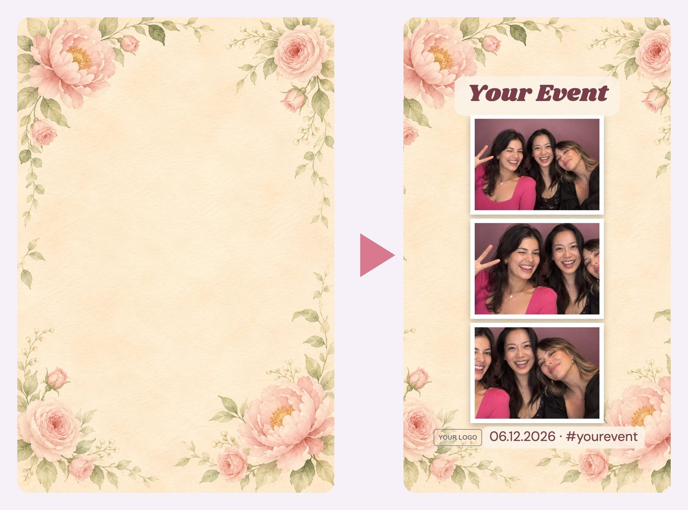

# Make frames with Codex

Every frame has background art: decoration around the edges, calm in the middle where the photos go. Codex draws that art for you on your ChatGPT plan. No API key and no per-image cost.

The booth adds the words itself: your event name, line 2 and your logo. So never ask for words in the art. AI still misspells them, and you'd have to redraw the frame every time the date changed.



## Before you start (once)

1. Install the **Codex app**: developers.openai.com/codex/app (Mac or Windows).
2. Open it and sign in with your ChatGPT account.

That's all. Claude finds the Codex that comes inside the app.

## Way 1: from Claude Code (easiest)

Say:

> **Make me a new frame called gold: black and gold art deco, like a 1920s party.**

What happens:
1. Claude runs `tools/make-frame.sh`, which hands Codex the frame rules (in `prompts/frame-brief.md`) plus your description.
2. Codex draws it. It usually takes about a minute.
3. The art lands in `public/frames/gold/`, with a `frame.json` and the frame added to your list.
4. Claude looks at it, checks it follows the rules, and picks colours for the borders and words to suit it.
5. You open the **frame preview** (`/preview?frame=gold`) and see it with sample photos.

Want to match something you already have? Drag it into the chat:

> **Make me a frame called launch that matches my invite** *(drag in invite.png)*

Then tweak it in normal words: "make the words gold", "tilt the photos", "less busy at the top", "try it again with more sparkle".

**Doing it yourself in the terminal:**

```bash
bash tools/make-frame.sh gold "black and gold art deco, like a 1920s party"
bash tools/make-frame.sh launch "match the colours and style of my invite" invite.png
```

## Way 2: inside Codex itself (good for Windows)

Open this folder in the Codex app and say:

> **Make a new booth frame called gold: black and gold art deco, like a 1920s party.**

Codex reads `AGENTS.md` in this folder, which tells it the frame rules and where to save everything. Codex draws with its own built-in image tool, so it doesn't need the script.

## Way 3: Canva (or your designer)

**Just the background:** design a 1080 × 1920 image with decoration around the edges and a calm middle. Download it as a JPG or PNG, save it as `public/frames/<name>/background.jpg`, and ask Claude to "set up this frame".

**An exact design, with holes for the photos:** use the layout guides in `docs/guides/`. `feed-guide.png` is 1080 × 1350 and `story-guide.png` is 1080 × 1920.
1. Make a Canva design at that exact size and put the guide in as the bottom layer.
2. Design around the grey boxes. The boxes are where the photos go, and the outlined boxes are where the booth writes your event name and adds your logo.
3. Delete the guide layer and download as a **PNG with a transparent background** (that needs Canva Pro).
4. Save them as `overlay-feed.png` and `overlay-story.png` in the frame's folder, and ask Claude to "use these as overlays for my <name> frame".

## Writing a good description

Name the **colours**, the **things** (flowers, disco balls, shells, confetti), and the **feeling**. One sentence is enough.

| Instead of | Try |
|---|---|
| "pretty" | "soft watercolour florals, blush pink and sage green, on cream paper" |
| "party" | "Y2K disco: chrome disco balls, hot pink sparkles, deep plum background" |
| "corporate" | "clean navy and white, thin gold lines in the corners, lots of white space" |
| "beachy" | "sunny beach: shells, palm leaves and little waves, turquoise and sand" |
| "Christmas" | "modern Christmas: green garland and gold baubles in the corners, deep green background" |

Avoid famous brands, characters and artists' names. Describe the look instead ("like a 1920s party", not "like The Great Gatsby film poster").

## When it doesn't come out right

| Problem | Say |
|---|---|
| Words or letters in the art | "Make it again, no lettering anywhere" |
| Too busy in the middle | "Make it again with a plain, calm middle" |
| A person or face snuck in | "Make it again, no people" |
| Colours not quite right | Usually a frame.json fix: "make the border blush pink" |
| Just not the vibe | Describe it again, differently. Each run is a fresh drawing |

If Codex says you've hit your usage limit, wait and try later. Image jobs use your Codex limits faster than normal chats. Making 3 or 4 frames in a sitting is fine.
